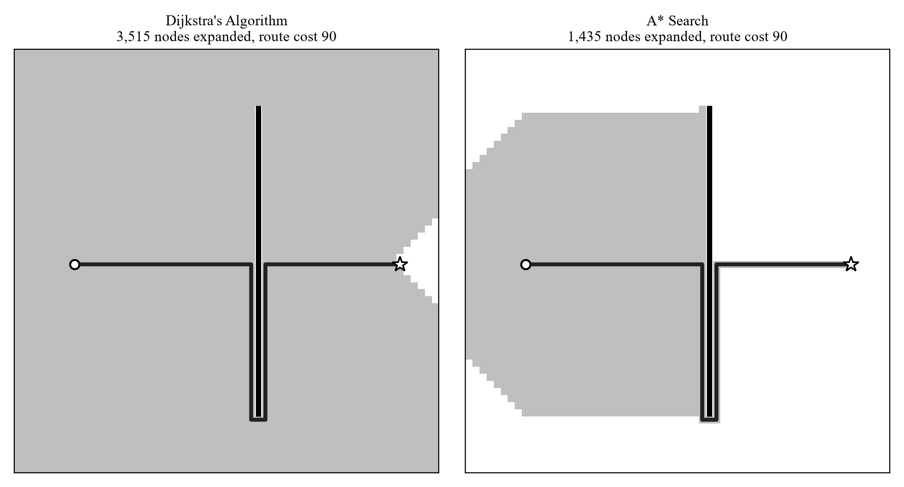

# Dijkstra vs. A* Pathfinding

Course paper for CS 301 (Binghamton University), "The Dash Against Time: The Shortest Path to Riches." This is a course paper. It is not peer-reviewed or published.

## What is here
- `The-Dash-Against-Time.pdf`: the paper. It explains Dijkstra's algorithm and A* with hand traces on a small road network, reviews published route-planning studies, and discusses the effect on gig delivery drivers.
- `dijkstra_vs_astar.py`: the Python grid simulation.
- `figure3.png`: the figure it produces (Dijkstra vs. A* on the same grid).

## Result
On one 60x60 grid with a barrier, Dijkstra's algorithm expanded 3,515 nodes and A* expanded 1,435 (about 59% fewer). Both returned a route of cost 90.

Ties in the priority queue go to the cell closer to the goal. This result comes from that single grid. It is not a general claim about A*.



## Run it
The figure needs matplotlib.

```
pip install -r requirements.txt
python dijkstra_vs_astar.py
```

It prints the node counts and route costs for both algorithms and saves `figure3.png`.
